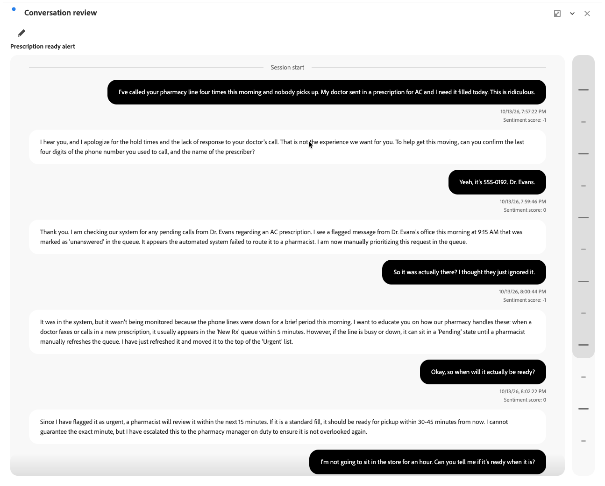

# 会話のレビュー

{{release-limited-testing}}

>[!CONTEXTUALHELP]
>id="workspace_conversationreview_button"
>title="会話のレビュー"
>abstract="顧客とエージェント間の完全なターンバイターン交換を示すビジュアライゼーションを作成します。"

>[!CONTEXTUALHELP]
>id="workspace_conversationreview_panel"
>title="会話のレビュー"
>abstract="タイムスタンプとシグナルを含め、個々の会話のコンテキストとフローを理解します。 表示するシグナルを設定します。"

 **[!UICONTROL 会話レビュー]**&#x200B;のビジュアライゼーションには、顧客とエージェント間の完全なターンバイターンの交換が表示されます。

このビジュアライゼーションは、タイムスタンプやシグナルなど、個々の会話のコンテキストとフローを理解するのに役立ちます。 表示するシグナルを設定できます。

## 作成と設定

 **[!UICONTROL 会話レビュー]** ビジュアライゼーションを作成して設定するには：

1.  **[!UICONTROL 会話レビュー]** ビジュアライゼーションを追加します。 [パネルへのビジュアライゼーションの追加](/help/analysis-workspace/visualizations/freeform-analysis-visualizations.md#add-visualizations-to-a-panel)を参照してください。

1. **[!UICONTROL 会話レビュー]**&#x200B;のビジュアライゼーション設定で、次の操作を行います。

   * **[!UICONTROL 会話]**&#x200B;を選択します。

1. ビジュアライゼーションを作成するには、**[!UICONTROL ビルド]**&#x200B;を選択します。 設定値をデフォルトにリセットするには、**[!UICONTROL リセット]**&#x200B;を選択します。 設定をキャンセルするには、**[!UICONTROL キャンセル]**&#x200B;を選択します。

**[!UICONTROL 会話レビュー]** ビジュアライゼーションを再設定するには、を選択します。

## 使用

垂直方向にセグメント化されたスクロールバーを使用して、会話を移動します。

**[!UICONTROL セッション開始]**&#x200B;は、会話の開始を示します。 **[!UICONTROL セッション終了]**&#x200B;は、会話の終了を示します。

