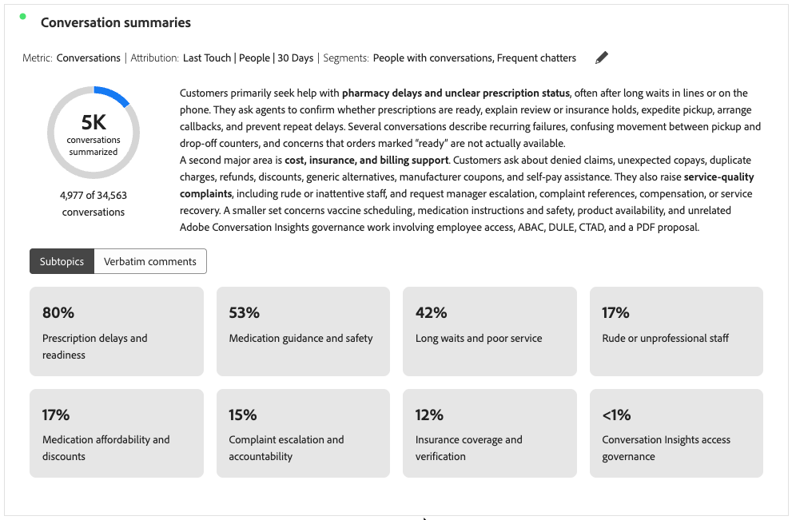
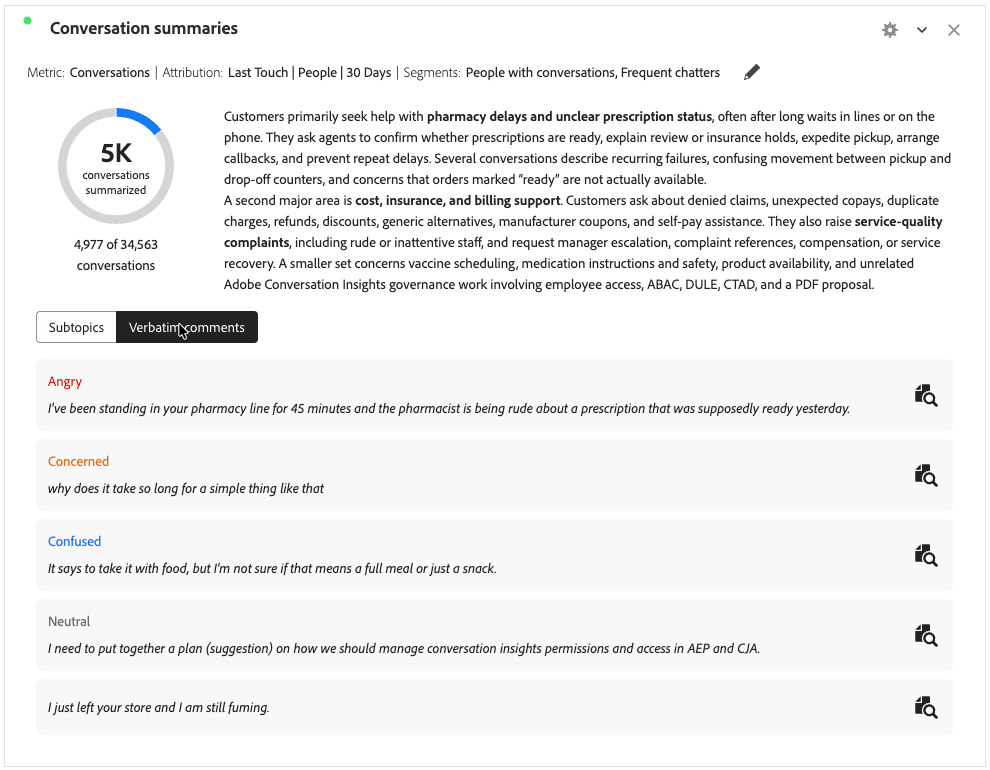

# 会話の要約 {#conversation-summaries}

>[!CONTEXTUALHELP]
>id="workspace_conversationsummaries_button"
>title="会話の要約"
>abstract="フィルタリングされた会話のグループを要約するビジュアライゼーションを作成します。"

>[!CONTEXTUALHELP]
>id="workspace_conversationsummaries_panel"
>title="会話の要約"
>abstract="フィルタリングされた会話のグループを要約します。 要約の長さを制御します。 抽出されたシグナルの正確性を検証するために、顧客からの代表的な引用を確認します。 見積もりを選択して、会話の全再生を開きます。"

{{release-limited-testing}}

 **[!UICONTROL 会話の要約]** ビジュアライゼーションを使用すると、[会話インサイト ](/help/conversation-insights/overview.md)の一部として、フィルタリングされた会話のグループを要約できます。

ビジュアライゼーションには、選択した指標（会話など）の概要が表示され、サブトピックを含めるようにビジュアライゼーションを設定すると、サブトピックまたは口語的なコメントが表示されます。

## 作成と設定 {#conversation-summaries-create-configure}

>[!CONTEXTUALHELP]
>id="workspace_conversationsummaries_usenondefaultattributionmodel"
>title="デフォルト以外のアトリビューションモデルを使用"
>abstract="この指標のデフォルト以外のアトリビューションモデルを有効にします。"

>[!CONTEXTUALHELP]
>id="workspace_conversationsummaries_usenondefaultattributionmodel_disabled"
>title="デフォルト以外のアトリビューションモデルを使用"
>abstract="この指標では、デフォルト以外のアトリビューションモデルは使用できません。"

**[!UICONTROL 会話サマリー]** ビジュアライゼーションを作成して設定するには：

1.  **[!UICONTROL 会話の概要]** ビジュアライゼーションを追加します。 [パネルへのビジュアライゼーションの追加](/help/analysis-workspace/visualizations/freeform-analysis-visualizations.md#add-visualizations-to-a-panel)を参照してください。

1. **[!UICONTROL 会話の概要]**&#x200B;のビジュアライゼーション設定で、次の操作を行います。

   1. **[!UICONTROL 指標]**&#x200B;を選択します。 例：**[!UICONTROL Conversations]**。
   1. 指標でデフォルト以外の[ アトリビューション ](/help/analysis-workspace/attribution/models.md) モデルを使用する場合は、オプションで、**[!UICONTROL デフォルト以外のアトリビューションモデルを使用]**&#x200B;を選択し、**[!UICONTROL モデル]**、**[!UICONTROL コンテナ]**&#x200B;および&#x200B;**[!UICONTROL ルックバックウィンドウ]**&#x200B;を選択します。
   1. オプションで、セグメントをビジュアライゼーションに適用できます。 「**[!UICONTROL セグメント]**」ドロップダウンメニューからセグメントを選択します。

1. ビジュアライゼーションを作成するには、**[!UICONTROL ビルド]**&#x200B;を選択します。 設定値をデフォルトにリセットするには、**[!UICONTROL リセット]**&#x200B;を選択します。 設定をキャンセルするには、**[!UICONTROL キャンセル]**&#x200B;を選択します。

**[!UICONTROL 会話の概要]** ビジュアライゼーションを再構成するには、**[!UICONTROL 指標：_指標_]**または&#x200B;**[!UICONTROL 指標：_指標_]** | **[!UICONTROL セグメント：_セグメント_]**の横にあるを選択します。

## 使用

ビジュアライゼーションを使用するには：

>[!BEGINTABS]

>[!TAB  サブトピック ]

>[!TAB 口語的なコメント ]

>[!ENDTABS]

* [ サブトピック ](#settings)が含まれている場合は、**[!UICONTROL サブトピック]**&#x200B;を選択してサブトピックを表示するか、**[!UICONTROL verbatim コメント]**&#x200B;を選択してverbatim コメントを表示します。
* **[!UICONTROL 音声コメント]**&#x200B;を選択した場合、を選択して、音声コメントが属する特定の会話に対する新しい[**[!UICONTROL 会話レビュー]**](./conversation-review.md) ビジュアライゼーションを開きます。

複数の会話レビューをすばやく参照するには：

1. **[!UICONTROL 会話ID]**&#x200B;と&#x200B;**[!UICONTROL 会話の名前]**&#x200B;をディメンションとして含む[ フリーフォームテーブル ](/help/analysis-workspace/visualizations/freeform-table/freeform-table.md)を作成します。
1. **[!UICONTROL 会話レビュー]** ビジュアライゼーションのデータソースとしてフリーフォームテーブルを選択します。

フリーフォームテーブルで会話を選択すると、**[!UICONTROL 会話レビュー]**&#x200B;が自動的に更新され、選択した会話の詳細が表示されます。

## 設定

次の特定の[ ビジュアライゼーション設定](/help/analysis-workspace/visualizations/freeform-analysis-visualizations.md#settings)を使用できます。

| 設定 | 説明 |
|---|---|
| **[!UICONTROL 概要の長さ]** | 概要の長さを指定します。 **[!UICONTROL ショート]**&#x200B;または&#x200B;**[!UICONTROL ロング]**&#x200B;のいずれかを選択できます。 |
| **[!UICONTROL サブトピックを含める]** | 「**[!UICONTROL サブトピックを含める]**」を選択して、ビジュアライゼーションにサブトピックを表示します。 **[!UICONTROL 最大サブトピック数]**&#x200B;を使用して、表示するサブトピックの最大数を設定します。 |
