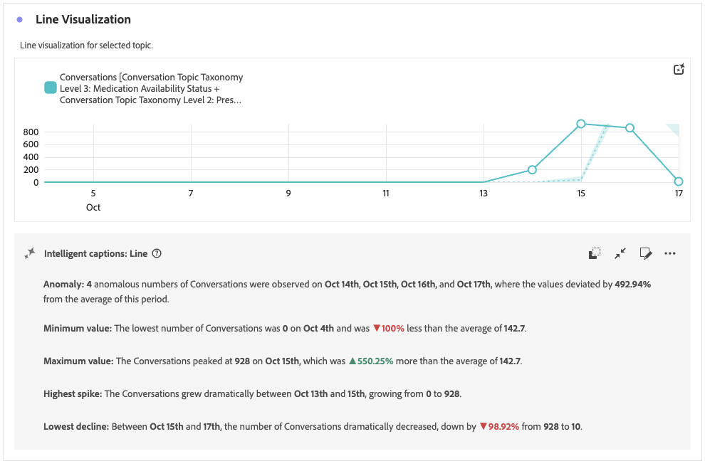

# トレンド分析トピック {#trending-topics}

>[!CONTEXTUALHELP]
>id="workspace_trendingtopics_button"
>title="トレンド分析トピック"
>abstract="階層的なドリルダウンを使用して、トレンドのトピックを出現率や割合で分類し、会話における重要なテーマを特定できるビジュアライゼーションを作成します。"

>[!CONTEXTUALHELP]
>id="workspace_trendingtopics_panel"
>title="トレンド分析トピック"
>abstract="選択したランキング指標にもとづいてトレンドトピックを分析します。 トピックを選択して、最大5つのレベルまでドリルダウンします。 特定のトピックを検索し、トピックを他の日付範囲と比較します。"

 **[!UICONTROL トレンド トピック]**&#x200B;のビジュアライゼーションを使用すると、会話インサイトの一部として、トレンド トピックを探索および分析できます。

特定のトピックを検索し、各レベルの各トピックの数と割合を他のデータ範囲と比較できます。

## 作成と設定 {#trendimg-topics-create-and-configure}

>[!CONTEXTUALHELP]
>id="workspace_trendingtopics_usenondefaultattributionmodel"
>title="デフォルト以外のアトリビューションモデルを使用"
>abstract="この指標のデフォルト以外のアトリビューションモデルを有効にします。"

>[!CONTEXTUALHELP]
>id="workspace_trendingtopics_usenondefaultattributionmodel_disabled"
>title="デフォルト以外のアトリビューションモデルを使用"
>abstract="この指標では、デフォルト以外のアトリビューションモデルは使用できません。"

**[!UICONTROL トレンドトピック]** ビジュアライゼーションを作成して設定するには：

1.  **[!UICONTROL トレンド トピック]** ビジュアライゼーションを追加します。 [パネルへのビジュアライゼーションの追加](/help/analysis-workspace/visualizations/freeform-analysis-visualizations.md#add-visualizations-to-a-panel)を参照してください。

1. **[!UICONTROL トレンドトピック]**&#x200B;のビジュアライゼーション設定で、次の操作を行います。

   1. **[!UICONTROL ランキング指標]**&#x200B;を選択します。 例：**[!UICONTROL Conversations]**。
   1. 指標でデフォルト以外の[&#x200B; アトリビューション &#x200B;](/help/analysis-workspace/attribution/models.md) モデルを使用する場合は、オプションで、**[!UICONTROL デフォルト以外のアトリビューションモデルを使用]**&#x200B;を選択し、**[!UICONTROL モデル]**、**[!UICONTROL コンテナ]**&#x200B;および&#x200B;**[!UICONTROL ルックバックウィンドウ]**&#x200B;を選択します。
1. ビジュアライゼーションを作成するには、**[!UICONTROL ビルド]**&#x200B;を選択します。 設定値をデフォルトにリセットするには、**[!UICONTROL リセット]**&#x200B;を選択します。

トレンド トピックのビジュアライゼーションを再構成するには、**[!UICONTROL ランキング指標：_ランキング指標_ | サブトピックレベル：_x_]**&#x200B;の横にあるを選択します。

## 使用

ビジュアライゼーションを使用するには：

* トピックにカーソルを合わせると、詳細が表示されるポップアップが表示されます。➊

* トピックのトレンドのサブトピックを下位レベルで表示するには、特定のレベルのトピックを選択します。 サブレベルで使用できるトピックがない場合は、 **[!UICONTROL サブトピックが見つかりません（_topic > subtopic > ...]**）。

*  **[!UICONTROL _トピックの検索_]**&#x200B;を使用すると、トピックをすばやく検索できます。➋

* トピックを別の日付範囲と比較するには、**[!UICONTROL 比較から]**&#x200B;までの日付範囲を選択します。➌

  カスタムの日付範囲を使用するには：

  * ドロップダウンメニューから「**[!UICONTROL カスタム日付範囲]**」を選択し、**[!UICONTROL 新しい日付範囲]** ダイアログで、カスタム日付範囲を定義して保存します。
  * カスタム日付範囲を選択し。

* 現在のトピック選択の折れ線グラフを表示するには、**[!UICONTROL トレンド トピック]** ビジュアライゼーションに[行](/help/analysis-workspace/visualizations/line.md) ビジュアライゼーションをドロップします。 **[!UICONTROL 行]**&#x200B;のビジュアライゼーションは、**[!UICONTROL トレンド トピック]**&#x200B;のビジュアライゼーションに自動的にリンクされ、選択したトピックの行が表示されます。

  

## 設定

次の特定の[&#x200B; ビジュアライゼーション設定](/help/analysis-workspace/visualizations/freeform-analysis-visualizations.md#settings)を使用できます。

| 設定 | 説明 |
|---|---|
| **[!UICONTROL 実際の値を表示]** | トピックの実際の値を表示します。 |
| **[!UICONTROL 表示率]** | トピックの割合を表示します。 |
