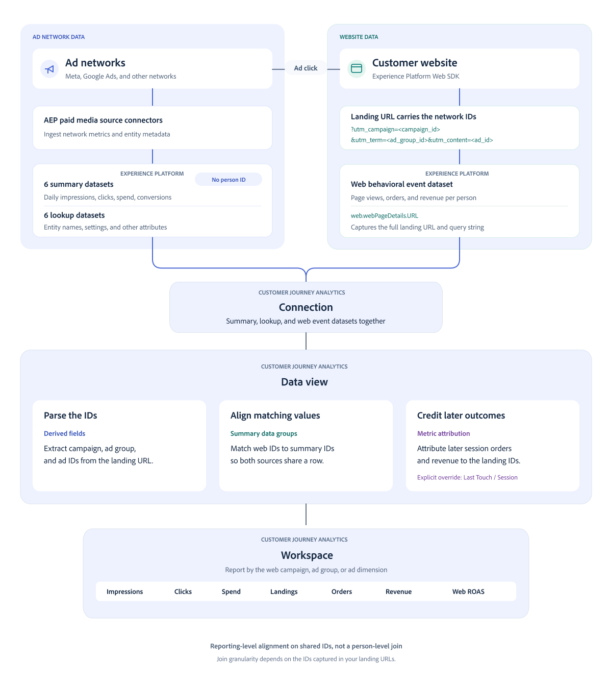

# 有料メディアデータをweb データに結合

このユースケースガイドでは、有料メディアの概要データを[!DNL Adobe Customer Journey Analytics]のweb サイト行動イベントデータと結合する方法を説明します。


広告アカウント（Meta、Google Adsなど）をExperience Platformに接続すると、アカウント、キャンペーン、広告グループ、広告、エクスペリエンス、アセットごとに、日次インプレッション数、クリック数、支出、広告ネットワークで報告されたコンバージョン数など、Customer Journey Analyticsの有料メディアの概要データが表示されます。 Customer Journey Analyticsを利用すれば、ページビュー、注文、売上などのwebSDKを通じて、独自のオンサイト行動イベントデータを収集できます。

これらのデータを1つのWorkspaceフリーフォームテーブルに結合することで、広告の効果とweb サイト上のアクティビティを比較できます。 共有されたキャンペーン、広告グループ、広告IDを使用して、[!DNL Analysis Workspace]のインプレッション数、クリック数、支出を、有料のランディング数、注文数、収益と並行してレポートします。

| データソース | 指標の例 |
|---|---|
| 有料メディアの概要データ | 広告ネットワークによって報告されたインプレッション数、クリック数、支出、コンバージョン数、コンバージョン値。 |
| web サイトの行動イベント | web サイトで測定される有料ランディングページ、ページビュー、注文、売上 |
| 計算指標 | ランディングページ率、web コンバージョン率、web広告費用対効果、web注文単価、ネットワークとwebのコンバージョン率の差 |

この2種類のデータを組み合わせることで、（広告の）クリック前のデータと（web サイトの）クリック後のデータを比較できます。

このガイドでは、[!DNL Adobe Content Analytics]個の設定によって管理される接続と、自分で設定した接続に基づいて、シナリオについて説明します。

## 仕組み

次の図は、Customer Journey Analytics接続を通じて、有料メディアの概要データとweb サイトの行動イベントデータがどのように取り込まれるかを示しています。

データビューはデータの解析と整列を担当するので、Workspaceを使用してデータを適切にレポートできます。

{zoomable="yes"}

ペイドメディアの概要データセットには、個人IDのない日々の指標が含まれています。 web サイトイベントデータセットには、タイムスタンプ付きの行動イベントと個人IDが含まれています。 概要データグループは、これらのデータセットからディメンションを関連付け、同じレポート行に同じディメンション値が表示されるようにします。

>[!IMPORTANT]
>
>この結合は、集計された概要データとレポート用のweb イベントを整合させます。 広告インプレッションをリンクしたり、個々のユーザーをクリックしたりすることはありません。 アドネットワークコンバージョンでは、ネットワークのレポート手法を維持します。 Web サイトの注文と収益は、このガイドで設定したアトリビューション設定を使用します。

## レポート結合について

ランディングページのURLまたは既存のイベントフィールドにIDが表示されるレベルでのみ結合できます。 例えば、キャンペーンのみのタグ付けはキャンペーンレポートをサポートしていますが、広告レベルのレポートはサポートしていません。

>[!NOTE]
>
>Content Analyticsのエクスペリエンスレベルとアセットレベルの結合には、追加のURL パラメーターが必要で、このガイドの対象外です。


参照については、[概要データ ](https://experienceleague.adobe.com/ja/docs/analytics-platform/using/cja-dataviews/summary-data)および[概要データグループコンポーネント設定](https://experienceleague.adobe.com/en/docs/analytics-platform/using/cja-dataviews/component-settings/summary-data-group)を参照してください。

### 結合キーを選択

ペイドメディアデータセットは、生のネットワーク IDとAdobeが生成したグローバル一意のID （GUID）の両方を提供します。

| 識別子 | 例 | 目的 |
|---|---|---|
| ネットワーク ID | キャンペーン ID `123456789` | ランディングページのURLから取得したIDを、有料メディアの概要ディメンションと照合します |
| GUID | `meta_111111111_123456789` | ネットワーク、アカウント、エンティティ階層を使用して、有料メディアエンティティを識別します |

GUID構造は`{adNetwork}_{accountID}[_{campaignID}[_{adGroupID}[_{adID}]]]`です。 [!DNL Adobe Content Analytics]によって管理される有料メディアコンポーネントでは、これらのGUIDが使用されます。

このガイドでは、キャンペーン、広告グループ、広告URL マクロでは、GUIDの再構築に必要なすべての情報が提供されないため、web結合にネットワーク IDを使用します。 次の概要フィールドを使用します。

| レポートレベル | ネットワーク ID フィールド | GUID フィールド |
|---|---|---|
| キャンペーン | `paidMedia.campaignID` | `paidMedia.campaignGUID` |
| 広告グループ | `paidMedia.adGroupID` | `paidMedia.adGroupGUID` |
| 広告 | `paidMedia.adID` | `paidMedia.adGUID` |

ネットワーク フィールドは`paidMedia.adNetwork`です。 値の例には、`meta`と`google_ads`が含まれます。 派生フィールド出力は、データセットの値と正確に一致する必要があります。

>[!NOTE]
>
>概要データグループは、テーブル内のすべてのディメンションの組み合わせではなく、ディメンション値と一致します。 選択したIDが、レポートを作成するアカウントやネットワーク全体でエンティティを明確に識別することを確認します。 名前ベースのグループは、名前を共有する個別のエンティティを組み合わせることができます。

## 前提条件

次があることを確認します。

* [!DNL Customer Journey Analytics]ここで使用されている派生フィールド関数にアクセスできるSelect以降：[URL解析](/help/data-views/derived-fields/derived-fields.md#url-parse)、[Case When](/help/data-views/derived-fields/derived-fields.md#case-when)、[正規表現の置換](/help/data-views/derived-fields/derived-fields.md#regex-replace)、および名前のエンリッチメント用に[参照](/help/data-views/derived-fields/derived-fields.md#lookup)。
* ターゲットサンドボックス内のスキーマ、データセット、データストリームを管理し、検証のためにデータセットとクエリサービスにアクセスするための[!DNL Adobe Experience Platform]権限。
* ターゲット接続とデータビューを編集するための[!DNL Customer Journey Analytics]権限。
* 同じサンドボックスで設定され、サマリーデータセットとルックアップデータセットを取り込む有料メディアソースコネクタ。 コネクタの例については、[Meta Ads source](https://experienceleague.adobe.com/en/docs/experience-platform/sources/connectors/advertising/meta-ads)を参照してください。
* クエリ文字列を含むランディングページのURL全体をキャプチャするweb サイトイベント、またはネットワーク IDを含む同等のフィールド。


### 広告のタグ付け

キャンペーン、広告グループ、広告IDを含むクエリパラメーターを特定します。 既存のID ベースのタグ付けは、広告プラットフォームを変更することなく使用できます。

| タグ付けパターン | キャンペーンパラメーター | 広告グループパラメーター | 広告パラメーター |
|---|---|---|---|
| web サイトのURLに表示されるMeta ID | <code>campaign_id={{campaign.id}}</code> | <code>adset_id={{adset.id}}</code> | <code>ad_id={{ad.id}}</code> |
| UTM パラメーターのMeta ID | <code>utm_campaign={{campaign.id}}</code> | <code>utm_term={{adset.id}}</code> | <code>utm_content={{ad.id}}</code> |
| UTM パラメーターのGoogle Ads ID | <code>utm_campaign={{campaignid}}</code> | <code>utm_term={{adgroupid}}</code> | <code>utm_content={{creative}}</code> |

Meta UTM タグ付けの場合、`utm_source=fb`などのソース値でネットワークを識別できます。 Google Ads UTM タグ付けには、`utm_source=google`などのソース値を使用します。

一部の[!DNL Adobe Advertising]統合では、このレイアウトで`s_kwcid`値が使用されています：

```text
AL!<id>!3!{creative}!{matchtype}!{placement}!{network}!{product_partition_id}!{keyword}!{campaignid}!{adgroupid}
```

このガイドの後半の解析ルールは、このレイアウトにのみ適用されます。 使用する前に、実際のランディング URLを調べます。

広告プラットフォームにアクセスできない場合は、web データセットのランディング URLを調べます。 これらの有料メディア検索フィールドを調べることもできます。

* Google Ads アカウント検索：`additionalDetails` エントリ名：`google_ads_tracking_url_template`および`google_ads_final_url_suffix`。
* Meta広告の検索：`paidMedia.adDetails.creative.paidMediaCreative.destinationURL`。

保存先URL内のマクロは、パーセントエンコードできます。 保存されたURLが最終的なランディング URLを表していると仮定するのではなく、実際のweb サイトイベントで展開されたIDを検証します。

>[!IMPORTANT]
>
>`utm_campaign=fall_sale`などのキャンペーン名がキャンペーン IDと一致しません。 実際のIDを含むレベルでのみ結合します。 IDが存在しない場合は、広告運用チームと協力して、今後のトラフィック用にタグ付けを更新します。この設定では、過去の訪問用に欠落しているIDを再構築することはできません。

### 開始点

使用するデータビューを開き、コンポーネントを調べて開始点を決定します。

| | 開始点 | 既存の設定 | 従うべき手順 |
|---|---|---|---|
| A | Content Analytics（web、モバイル、有料メディア） | [有料メディアデータセットとコンポーネント ](/help/content-analytics/config/paid-media.md)、およびContent Analytics イベントとルックアップデータセット。 | 必要に応じてweb サイトのイベントデータセットを追加し、web派生フィールドとレポートグループを設定します。 |
| B | Content Analytics（有料メディアのみ） | [有料メディアデータセットとコンポーネント ](/help/content-analytics/config/paid-media.md)。共有コンテンツ参照データセットも使用できます。 | web サイトのイベントデータセットを追加し、web派生フィールドとレポートグループを設定します。 |
| C | Content Analyticsのプロビジョニング機能のない有料メディア | Experience Platformには有料メディアデータセットがありますが、コネクションとデータビューには有料メディア設定が含まれていません。 | web サイトと有料メディアデータセットを追加してから、有料メディアとweb コンポーネントを作成します。 |
| D | 有料メディアを使用しないContent Analytics | Content Analyticsのコンポーネントのみ。 | Content Analytics設定で有料メディアチャネルを有効にしてから、既存の設定パスに従います。 |

Content Analyticsで管理する接続を拡張する場合は、システムがプロビジョニングしたデータセットや読み取り専用コンポーネントを削除または変更しないでください。

## web サイト行動イベントの収集

Web サイトで必要なイベントがCustomer Journey Analyticsで使用されるデータセットにすでに送信されている場合は、スキーマ、データセット、データストリームの作成をスキップします。 `web.webPageDetails.URL`にランディングページクエリ文字列が含まれていることを確認します。

### スキーマとデータセットの作成

1. Experience Platformで、ターゲットサンドボックスを選択します。
1. **[!UICONTROL データ管理]** > **[!UICONTROL スキーマ]**&#x200B;に移動し、**[!UICONTROL スキーマの作成]**&#x200B;を選択します。
1. **[!UICONTROL Manual]**&#x200B;と`XDM ExperienceEvent` クラスを選択します。
1. スキーマに名前を付けます（例：`Web Behavioral Events`）。
1. 実装に必要なフィールドグループを追加します。

   | フィールドグループ | 必要なデータ |
   |---|---|
   | AEP Web SDK ExperienceEvent | ページ URL、ページビュー、リファラー、その他のweb コンテキスト。 |
   | コマースの詳細 | 購入数、注文額、通貨、購入ID、商品詳細。 |
   | キャンペーンマーケティング詳細（オプション） | トラッキングコードは、実装が個別にキャプチャする場合に使用します。 |
   | IdentityMapが存在しない場合 | ECIDなどの個人ID。 |

1. スキーマを保存します。 このレポートのユースケースでは、プロファイルの有効化は必要ありません。
1. **[!UICONTROL データ管理]** > **[!UICONTROL データセット]** > **[!UICONTROL データセットの作成]** > **[!UICONTROL スキーマからのデータセットの作成]**&#x200B;に移動します。
1. スキーマを選択し、`Web Behavioral Events`などの名前のデータセットを作成します。 別のユースケースで必要な場合を除き、**[!UICONTROL プロファイル]**&#x200B;を無効のままにします。

### データストリームとWeb SDKの設定

1. **[!UICONTROL データ収集]** > **[!UICONTROL データストリーム]** > **[!UICONTROL 新しいデータストリーム]**&#x200B;に移動します。
1. データストリームに名前を付け、イベントスキーマをマッピングスキーマとして選択します。
1. 保存し、**[!UICONTROL Add Service]** > **[!UICONTROL Adobe Experience Platform]**&#x200B;を選択します。
1. サンドボックスとイベントデータセットを選択し、**[!UICONTROL 保存]**&#x200B;します。
1. データストリーム IDを使用して、[Experience Platform Web SDK](https://experienceleague.adobe.com/en/docs/experience-platform/collection/js/js-overview)を設定します。

以下をキャプチャします。

* `web.webPageDetails.URL`と`web.webPageDetails.pageViews.value`の完全なURLが`1`に設定された各ページのページビューをキャプチャします。
* `commerce.purchases.value`が`1`に設定され、さらに`commerce.order.priceTotal`、`commerce.order.currencyCode`および`commerce.order.purchaseID`が設定された購入イベント。
* Customer Journey Analytics接続に適した人物ID。

Web サイトのコードでUTM パラメーターを解析する必要はありません。 このガイドの派生フィールドは、レポート時にURLを解析します。 実装で既に専用フィールドのIDをキャプチャしている場合は、代わりにこれらのフィールドを使用します。

### 取り込みを確認

正常に取り込むためにデータセットアクティビティを確認します。 クエリサービスで、次のクエリを実行し、`web_behavioral_events`をデータセットのSQL テーブル名に置き換えます。

```sql
SELECT timestamp, eventType, web.webPageDetails.URL
FROM web_behavioral_events
WHERE web.webPageDetails.URL RLIKE '[?&](campaign_id|utm_campaign|s_kwcid)='
ORDER BY timestamp DESC
LIMIT 20;
```

返されたURLに拡張ネットワーク IDが含まれていることを確認します。 有料トラフィックが存在するが、クエリが行を返さない場合は、最近のランディング URLを調べ、タグ付けにパラメーターパターンを適応させます。

## 接続の設定

Web イベントデータセットをCustomer Journey Analyticsに取り込むには、データセットを関連する接続に追加する必要があります。 これにより、web行動イベントが、有料メディアデータセットとともに分析に利用できるようになります。

### web サイトイベントデータセットの追加

1. Customer Journey Analyticsで、**[!UICONTROL Data management]** > **[!UICONTROL Connections]**&#x200B;に移動します。
1. 有料メディアデータセットを含む接続を編集します。
1. 「**[!UICONTROL データセットを追加]**」を選択し、web サイトイベントデータセットを選択します。
1. データセットを設定します。

   | 設定 | 値 |
   |---|---|
   | ユーザー ID | ECID名前空間または実装の人物ID フィールドを持つ`identityMap`。 |
   | タイムスタンプ | `timestamp` |
   | データソースタイプ | web データ |
   | すべての新しいデータを読み込み | 有効化 |
   | 既存のすべてのデータをバックフィル | 必要な履歴の期間に対して有効になります。 |

1. データセットを追加し、接続を保存します。

### まだ設定されていない場合は、有料メディアデータセットを追加します

>[!IMPORTANT]
>
>Content Analyticsが有料メディアデータセットを管理する接続については、この節をスキップしてください。


少なくとも有料メディア広告の概要と有料メディアアカウント、有料メディアキャンペーン、有料メディア広告グループ、有料メディア広告ルックアップデータセットを追加します。

| データセット | タイプ | キー設定 |
|---|---|---|
| 有料メディア広告の概要 | 概要 | スキーマの毎日のタイムスタンプ設定を使用します。新しいデータのインポートと必要なバックフィルを有効にします。 |
| 有料メディアアカウントの検索 | Lookup | キー：`paidMedia.accountGUID`。広告の概要：`paidMedia.accountGUID`のフィールドに一致します。 |
| 有料メディアキャンペーンの検索 | Lookup | キー：`paidMedia.campaignGUID`。広告の概要：`paidMedia.campaignGUID`のフィールドに一致します。 |
| 有料メディア広告グループの検索 | Lookup | キー：`paidMedia.adGroupGUID`。広告の概要：`paidMedia.adGroupGUID`のフィールドに一致します。 |
| 有料メディア広告の検索 | Lookup | キー：`paidMedia.adGUID`。広告の概要：`paidMedia.adGUID`のフィールドに一致します。 |

保存する前に、接続エディターが目的のマッチングフィールドを公開することを確認します。 このガイドの後半の名前のエンリッチメントでは、派生フィールドのルックアップルールを明示的に使用します。

その他の利用可能なサマリーデータセットは、地理、デモグラフィック、配置、パフォーマンスなどの分類が必要な場合にのみ追加できます。

## データビューの設定

**[!UICONTROL データ管理]** > **[!UICONTROL データビュー]**&#x200B;を開き、データビューを選択します。 必要に応じて、設定した接続を使用してデータビューを作成します。

新しいデータビューの場合は、GMTを使用してweb サイトイベントをUTC有料メディア日に合わせ、レポート要件が異なる場合を除き、デフォルトの30分のセッションタイムアウトを維持します。 既存のデータビューのタイムゾーンを変更すると、他のレポートに影響が及びます。変更する前に、その影響を評価してください。

### まだ設定されていない場合は、有料メディア指標を追加します

これらの指標またはディメンションが既に存在する場合は、この手順をスキップします。 **[!UICONTROL 有料メディア広告の概要]**&#x200B;から次のフィールドを追加します。

| コンポーネント名 | スキーマフィールド | 形式 |
|---|---|---|
| **指標** | | |
| インプレッション広告の概要 | `paidMedia.metrics.impressions` | 小数 |
| 広告の概要をクリック | `paidMedia.metrics.clicks` | 小数 |
| 広告の概要を費やす | `paidMedia.metrics.spend` | 通貨 |
| コンバージョン \|広告の概要 | `paidMedia.metrics.conversions` | 小数 |
| コンバージョン値\|広告の概要 | `paidMedia.metrics.conversionValue` | 通貨 |
| **ディメンション** | | |
| 広告ネットワーク | `paidMedia.adNetwork` | 文字列 |
| アカウント GUID | `paidMedia.accountGUID` | 文字列 |
| キャンペーン GUID | `paidMedia.campaignGUID` | 文字列 |
| AdGroup GUID | `paidMedia.adGroupGUID` | 文字列 |
| 広告 GUID | `paidMedia.adGUID` | 文字列 |

通貨のフォーマット自体は、異なるソース通貨を調整しません。 支出と収益を比較する前に、通貨ベースを確認します。

派生フィールドを使用して、GUID ディメンションのわかりやすい名前を作成します。 GUID ディメンションにわかりやすい名前を適用するには、[参照](/help/data-views/derived-fields/derived-fields.md#lookup) ルールを使用します。  例：**[!UICONTROL paidMedia.accountGUID （有料メディア広告の概要）]**&#x200B;を、一致するキー`paidMedia.accountGUID`と返す値`paidMedia.accountDetails.accountName`を含むルックアップデータセット **[!UICONTROL 有料メディアアカウントのルックアップ]**&#x200B;を使用して検索します。


### Web ネットワーク派生フィールドの作成

**[!UICONTROL 派生フィールドを作成]**&#x200B;を選択し、フィールドに`PM Network (Web)`という名前を付けます。 以下のすべての[URL解析](/help/data-views/derived-fields/derived-fields.md#url-parse) ルールは、web サイトデータセットの`web.webPageDetails.URL` フィールドを読み取ります。このフィールドはページ URLと呼ばれます。

ルールを次の順序で追加します。

| 規則 | 関数 | 設定 |
|---|---|---|
| 1 | [URL解析](/help/data-views/derived-fields/derived-fields.md#url-parse) | ページ URL。 `utm_source`のクエリ文字列値を取得します。 |
| 2 | [URL解析](/help/data-views/derived-fields/derived-fields.md#url-parse) | ページ URL。 `s_kwcid`のクエリ文字列値を取得します。 |
| 3 | [URL解析](/help/data-views/derived-fields/derived-fields.md#url-parse) | ページ URL。 `gclid`のクエリ文字列値を取得します。 |
| 4 | [URL解析](/help/data-views/derived-fields/derived-fields.md#url-parse) | ページ URL。 `fbclid`のクエリ文字列値を取得します。 |
| 5 | ](/help/data-views/derived-fields/derived-fields.md#case-when)の場合[ ケース | 以下の条件を適用します。 |

最後の[Case When](/help/data-views/derived-fields/derived-fields.md#case-when) ルールを設定します。

1. ルール 2またはルール 3が設定されている場合は、`google_ads`を返します。
1. ルール 4が設定されている場合、またはルール 1が`fb`、`facebook`、`ig`、`instagram`または`meta`に等しい場合は、`meta`を返します。
1. ルール 1が`google`に等しい場合は、`google_ads`を返します。
1. 他のネットワークのマッピングは、`paidMedia.adNetwork`で値を確認した後にのみ追加します。
1. それ以外の場合は値を返しません。

固定出力を入力するには、値ピッカーを開き、**[!UICONTROL カスタム文字列値]**&#x200B;を選択して、文字列を入力します。

これらの分類ルールはタグ付けにもとづいたもので、有料広告からの訪問を示すものではありません。 例えば、ソースパラメーターだけでも、有料でないリンクにも表示できます。 フィールドを有料トラフィック分類子として使用する前に、条件をタグ付け規則に適応させます。

### Web ID派生フィールドの作成

レポートレベルごとに1つの派生フィールドを作成します。 次の構造は、前述の3つのタグ付けパターンを処理します。

| 規則 | 関数 | 設定 |
|---|---|---|
| 1 | [URL解析](/help/data-views/derived-fields/derived-fields.md#url-parse) | ページ URLからレベル固有のMeta パラメーターを読み取ります。 |
| 2 | [URL解析](/help/data-views/derived-fields/derived-fields.md#url-parse) | ページ URLからレベル固有のUTM パラメーターを読み取ります。 |
| 3 | [URL解析](/help/data-views/derived-fields/derived-fields.md#url-parse) | ページ URLから`s_kwcid`を読み取ります。 |
| 4 | [正規表現の置換](/help/data-views/derived-fields/derived-fields.md#regex-replace) | レベル固有の式をルール 3に適用します。出力`$1`。 |
| 5 | ](/help/data-views/derived-fields/derived-fields.md#case-when)の場合[ ケース | ルール 3が設定されている場合はルール 4を返します。設定されていない場合はルール 1を返します。設定されていない場合はルール 2を返します。 |

次の値を使用します。

| 派生フィールド | Meta パラメーター | UTM パラメーター | 正規表現 |
|---|---|---|---|
| **PM キャンペーン ID （Web）** | `campaign_id` | `utm_campaign` | `^.*!([^!]*)![^!]*$` |
| **PM広告グループ ID （Web）** | `adset_id` | `utm_term` | `^.*!([^!]*)$` |
| **PM Ad ID （Web）** | `ad_id` | `utm_content` | `^[^!]*![^!]*![^!]*!([^!]*)!.*$` |

最後の[Case When](/help/data-views/derived-fields/derived-fields.md#case-when) ルールでは、リテラル文字列として入力するのではなく、値ピッカーから以前のルール出力を選択します。

キャンペーン式は2番目から最後の`s_kwcid`値を抽出し、広告グループ式は最後の値を抽出し、広告式は4番目の値を抽出します。 これらの位置は、先に示した正確なレイアウトによって異なります。

**[!UICONTROL 最終出力]**&#x200B;を使用して、結果が有料メディア広告サマリーのIDと一致することを確認します。 URLで別のレイアウトが使用されている場合は、`s_kwcid`解析ブランチを保持しないでください。 URLでUTM パラメーターのみを使用する場合は、未使用のルールを省略し、それに応じて後続のルール参照を更新します。

各派生フィールドは、最大5つの[URL解析ルール ](/help/data-views/derived-fields/derived-fields.md#url-parse)と1つの[正規表現ルール ](/help/data-views/derived-fields/derived-fields.md#regex-replace)をサポートします。 派生フィールドごとに1つのIDを保持します。

### 有料着陸メトリックの作成

`PM Campaign ID (Web)`を入力として使用して、`Paid Media Landings (Web)`という名前の派生フィールドを作成します。

ビルダーは、入力フィールドのルールを新しいフィールドに展開します。 これらのルールの後に、キャンペーン ID出力が設定されたときにカスタム数値`1`を返す[Case When](/help/data-views/derived-fields/derived-fields.md#case-when) ルールを追加し、それ以外の値は追加しません。 結果を指標として追加します。

この指標は、キャンペーン IDを含むイベントをカウントします。 この指標は、実装が繰り返しまたは無関係なイベントではなく、ランディングイベントにそのIDを含むURLを送信する場合にのみ、ランディングを表します。

>[!NOTE]
>
>展開された派生フィールドルールはコピーです。 ID フィールドを変更する場合は、対応するランディングフィールドと名前フィールドも確認して更新します。 ルールの解析を省略した場合は、ルール 5であると仮定するのではなく、実際の最終的なID ルールを参照してください。

### オプションのweb名フィールドの追加

名前でレポートするには、展開されたweb ID ルールの後に[参照ルール ](/help/data-views/derived-fields/derived-fields.md#lookup)を含む次の派生フィールドを作成します。

| 派生フィールド | 入力 | ルックアップデータセット | 一致するフィールド | リターンフィールド |
|---|---|---|---|---|
| PM キャンペーン名（Web） | PM Campaign IDの最終出力（Web） | 有料メディアキャンペーンの検索 | `paidMedia.campaignID` | `paidMedia.metadata.name` |
| PM広告グループ名（Web） | PM Ad Group IDの最終出力（Web） | 有料メディア広告グループの検索 | `paidMedia.adGroupID` | `paidMedia.metadata.name` |
| PMの広告名（Web） | PM Ad IDの最終出力（Web） | 有料メディア広告の検索 | `paidMedia.adID` | `paidMedia.metadata.name` |

ルックアップを適用するフィールドとして、最終的なID ルールを選択します。 フィールドをディメンションとして追加する前に、最終出力プレビューで名前を確認します。 必須の一致フィールドが使用できない場合は、代わりにID ベースのレポートを使用します。

名前はテキストとして一致します。 異なるエンティティが名前を共有する場合は、ID ディメンションを使用します。

### Web コンポーネントの追加とアトリビューションの設定

Web IDとネットワーク派生フィールドをディメンションとして追加します。 オプションの名前フィールドを作成した場合は、追加します。 コンポーネント設定をデフォルトのままにして、グループに追加する概要ディメンションと一致させます。

データビューに、必要なweb コンポーネントが含まれていることを確認します。

| コンポーネント | タイプ | スキーマフィールド |
|---|---|---|
| ページ URL | ディメンション | `web.webPageDetails.URL` |
| ページ名 | ディメンション | `web.webPageDetails.name` |
| リファラー URL | ディメンション | `web.webReferrer.URL` |
| イベントタイプ | ディメンション | `eventType` |
| 製品 SKU | ディメンション | `productListItems.SKU` |
| 製品名 | ディメンション | `productListItems.name` |
| ページビュー数 | 指標 | `web.webPageDetails.pageViews.value` |
| カートに追加 | 指標 | `commerce.productListAdds.value` |
| 注文件数 | 指標 | `commerce.purchases.value` |
| 売上高 | 指標 | `commerce.order.priceTotal` |

有料着陸派生フィールドを指標として追加し、注文と収益の指標を個別に設定します。

1. **[!UICONTROL オーダー]**&#x200B;を複製し、コピーに`Orders (Web)`という名前を付けます。 **[!UICONTROL 注文]**&#x200B;が存在しない場合は、`commerce.purchases.value`を直接追加します。
1. **[!UICONTROL 収益]**&#x200B;を複製し、コピーに`Revenue (Web)`という名前を付けます。 **[!UICONTROL 収益]**&#x200B;が存在しない場合は、`commerce.order.priceTotal`を直接追加してください。
1. **[!UICONTROL 注文（Web）]**&#x200B;を小数点以下桁ゼロの10進数で、収益（Web） ]**を通貨として書式設定します。**[!UICONTROL 
1. 両方の指標について、**[!UICONTROL アトリビューション]**&#x200B;を開き、**[!UICONTROL デフォルトのアトリビューションを上書き]**&#x200B;を有効にします。
1. **[!UICONTROL ラストタッチ]** モデルと&#x200B;**[!UICONTROL セッション]** コンテナを選択します。

既存のレポートを保持するために、元の&#x200B;**[!UICONTROL 注文]**&#x200B;および&#x200B;**[!UICONTROL 収益]**&#x200B;指標を変更しないでください。 表示されているデフォルトが一致するように見える場合でも、この設定では上書きを明示的に有効にする必要があります。

再訪問時のコンバージョンクレジットについては、**[!UICONTROL 人物]** コンテナと適切なルックバックウィンドウを代わりに考慮してください。 [概要データの使用例](https://experienceleague.adobe.com/en/docs/analytics-platform/using/cja-usecases/data-views/summary-data)を参照してください。

web ID ディメンションに永続性を追加するのではなく、指標アトリビューションを使用します。 ランディングとして解釈されるカウントの膨張を避けるために、後のイベントにIDを保持しないでください。これは、キャンペーン行の下に表示されるイベントが変更されるためです。

### サマリーサイド結合ディメンションの作成

Web結合の有料メディア広告サマリーから個別のディメンションを追加します。

| コンポーネント名 | スキーマフィールド |
|---|---|
| 広告ネットワーク （参加） | `paidMedia.adNetwork` |
| キャンペーン ID （ネットワーク） | `paidMedia.campaignID` |
| 広告グループ ID （ネットワーク） | `paidMedia.adGroupID` |
| 広告ID （ネットワーク） | `paidMedia.adID` |

テンプレートで管理される読み取り専用の有料メディアコンポーネントを編集したり、重複したりしないでください。 上記のスキーマフィールドから個別のコンポーネントを作成します。

オプションのweb名フィールドを作成した場合は、次のサマリーサイドルックアップ派生フィールドも作成します。

| コンポーネント名 | 広告サマリーからの入力 | ルックアップデータセット | 一致するフィールド | リターンフィールド |
|---|---|---|---|---|
| キャンペーン名（参加） | `paidMedia.campaignGUID` | 有料メディアキャンペーンの検索 | `paidMedia.campaignGUID` | `paidMedia.metadata.name` |
| 広告グループ名（参加） | `paidMedia.adGroupGUID` | 有料メディア広告グループの検索 | `paidMedia.adGroupGUID` | `paidMedia.metadata.name` |
| 広告名（参加） | `paidMedia.adGUID` | 有料メディア広告の検索 | `paidMedia.adGUID` | `paidMedia.metadata.name` |

各ルックアップの入力として、サマリーデータセットのGUIDを使用します。 参照データセットから直接取得されたディメンションは、概要データグループの概要ディメンションの要件を満たしません。

### 概要データグループの作成

レポートで使用するWeb ディメンション上の各グループを作成します。 対応する概要ディメンションを追加し、レポートで追加されたメンバーを非表示にします。

| Web ディメンション：ここでグループを作成します | 概要ディメンション：非表示メンバーとして追加 |
|---|---|
| PM ネットワーク （Web） | 広告ネットワーク （参加） |
| PM キャンペーン ID （Web） | キャンペーン ID （ネットワーク） |
| PM広告グループ ID （Web） | 広告グループ ID （ネットワーク） |
| PM Ad ID （Web） | 広告ID （ネットワーク） |
| PM キャンペーン名（Web）、オプション | キャンペーン名（参加） |
| PM広告グループ名（Web）、オプション | 広告グループ名（参加） |
| PM広告名（Web）、オプション | 広告名（参加） |

各行について：

1. Web ディメンションを選択します。
1. **[!UICONTROL 概要データグループ]**&#x200B;を開き、**[!UICONTROL グループ化の作成]**&#x200B;を有効にします。
1. 概要ディメンションを追加します。
1. 追加されたサマリーメンバーについて、**[!UICONTROL レポートで非表示]**&#x200B;を有効にします。 Web ディメンションを表示したままにします。
1. 小文字、部分文字列、含める/除外ルールなどのコンポーネント設定がメンバー間で一致することを確認します。

各グループは最大10次元をサポートします。 別のサマリーデータセットの指標を含めるには、そのデータセットの同等のサマリーディメンションを、非表示のメンバーと同じグループに追加します。

>[!IMPORTANT]
>
>Web ディメンションをレポートディメンションとして使用し、そのディメンションにグループを作成します。 リバース配置では、対応するweb指標なしでサマリー指標を表示できます。

データビューを保存します。

### 計算指標の作成

Workspaceで、**[!UICONTROL コンポーネント]** > **[!UICONTROL 計算指標]**&#x200B;に移動し、設定されたデータビューを使用して次の指標を作成します。

| 名前 | 定義 | 形式 |
|---|---|---|
| ランディング率 | 有料メディアのランディング （Web） / クリック数\|広告の概要 | パーセント |
| web コンバージョン率 | 注文（Web）/有料メディアのランディング（Web） | パーセント |
| Web ROAS | 収益（Web） / 費用の広告サマリー | 小数点以下二桁 |
| Web注文あたりのコスト | 広告の概要/注文の支出（Web） | 通貨 |
| ネットワークとweb コンバージョンのギャップ | コンバージョン \|広告概要 – 注文（Web） | 小数点以下桁、0桁 |

比率の指標を解釈する前に、ゼロの分母を持つ行を確認します。 ネットワークとwebのコンバージョンギャップだけではエラーは示されません。ふたつのソースでは、アトリビューションウィンドウ、測定ウィンドウ、レポートウィンドウが異なる場合があります。

## レポートの作成と検証

1. 設定されたデータビューを使用して、Workspace プロジェクトを作成します。
1. 両方のソースから取得したデータで日付範囲を選択します。 有料メディアの取り込みに遅延が発生することを許可します。概要データは、web サイトのイベントを1日遅らせる可能性があります。
1. 行ディメンションとして&#x200B;**[!UICONTROL PM キャンペーン ID （Web）]**&#x200B;を含むフリーフォームテーブルを追加するか、名前グループを設定した場合は&#x200B;**[!UICONTROL PM キャンペーン名（Web）]**&#x200B;を追加します。
1. **[!UICONTROL インプレッション |広告サマリー]**、**[!UICONTROL クリック |広告サマリー]**、**[!UICONTROL 費用|広告サマリー]**、**[!UICONTROL コンバージョン |広告サマリー]**、**[!UICONTROL 有料メディア ランディング |広告サマリー]**、**[!UICONTROL 注文（Web）]**、**[!UICONTROL 収益（Web）]**&#x200B;および計算指標を追加します。
1. web広告グループと広告ディメンションごとにキャンペーン行を分割します。 設定された各レベルに概要とweb指標の両方が入力されていることを確認します。
1. **[!UICONTROL PM ネットワーク （Web）]**&#x200B;を使用して2番目のテーブルを追加し、ネットワークレベルの合計と値なし行を確認します。

   

   

レポートを共有する前に、次の点を確認してください。

* ランディングイベント IDは、有料メディア広告の概要IDと一致します。
* ペイドメディアの指標とweb指標は、同じ行に入力されます。
* 注文と売上には、意図したセッションまたは個人のアトリビューションが適用されます。
* 値のない行が理解されます。 有料メディア識別子を使用せずに、一致しない概要データやweb アクティビティを含めることができます。
* クリックによる差異は、収集の設定、同意処理、レポートウィンドウと一致しています。 予期される一致率が存在しません。

### 不一致のトラブルシューティング

| 症状 | チェックと修正アクション |
|---|---|
| 概要指標は入力されますが、すべてのweb指標は0です | 行でweb ディメンションを使用し、それらのディメンションでグループが作成されていることを確認します。 次に、名前ではなく実際のIDのランディング URLを調べます。 |
| Web指標は入力されますが、概要レベルが空です | レベルの概要ディメンションが対応するグループにあり、選択した日付に一致する有料メディアデータが存在することを確認します。 |
| Web行に名前がありません | 最終的な出力プレビューの「参照の入力と一致」フィールドを確認します。 名前のエンリッチメントが利用できない場合は、ID グループを使用します。 |
| Web IDには、リテラルまたはエンコードされたマクロが含まれています | 広告運用チームに、宛先URLを検査し、ネットワークが着陸前にマクロを展開することを確認するように依頼します。 |
| Google Ads IDが一致しません | 実際の`s_kwcid` レイアウトまたはUTM パラメーターを調べ、解析ルールを更新します。 |
| ネットワーク値は、`facebook`や`meta`のように分割されます | ネットワーク派生フィールド出力を`paidMedia.adNetwork`と正確に一致させます。 |
| IDが別々の行に表示されます | 設定がグループ化されたディメンション間で一致することを確認し、基になる文字列値を調べます。 |
| web サイトのアクティビティが1日ずつ変化 | データビューのタイムゾーンとUTCのサマリー日の境界を比較します。 |
| キャンペーンで注文や売上がゼロまたは予想外に少ない | 指標アトリビューションの上書きを明示的に有効にし、モデル、コンテナ、ルックバックの設定を確認します。 |
| 有料着陸は予想外に高い | ランディングイベントのみが、カウントされたキャンペーンパラメーターを保持することを確認します。 繰り返されるID準拠イベントも、この指標に影響します。 |
| 異なるキャンペーンは名前行を共有します | ID ベースのレポートを使用して、同じ名前を持つエンティティを区別します。 |
